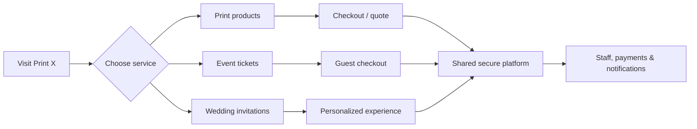
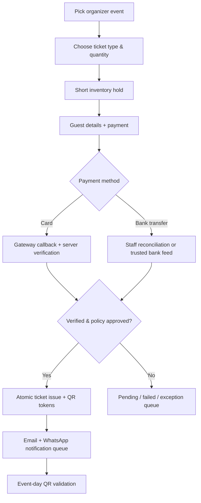
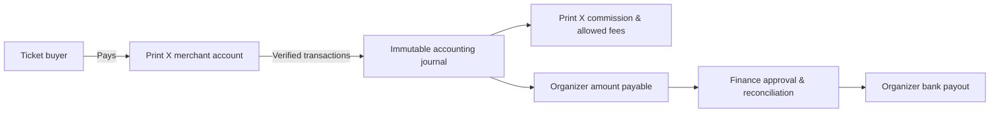
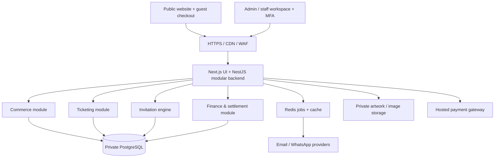
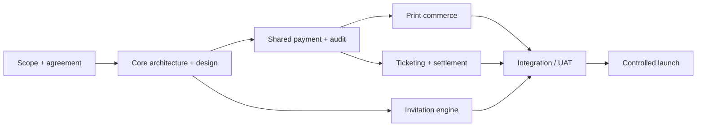

# PRINT X
### The Digital Print • Events • Invitations Platform

> **Product & Development Master Plan**  
> **Edition:** 1.0 · **Status:** Proposed implementation roadmap · **Website:** `printxads.lk` · **Market:** Sri Lanka · **Currency:** LKR

---

## The big picture

**One welcoming website. Three customer experiences. One reliable operations system.**

| 🖨️ PRINT SHOP | 🎟️ EVENT TICKETING | 💌 E-INVITATIONS |
|:---|:---|:---|
| Browse products, customize sizes and finishes, upload artwork, pay and track print jobs. | Buy external-organizer event tickets **without an account**, receive QR tickets and get checked in. | Open cinematic, animated, personally addressed wedding pages with RSVP and map links. |
| **Business objective:** convert inquiries into trackable orders. | **Business objective:** sell accurately and settle organizers transparently. | **Business objective:** deliver unique premium digital experiences at scale. |

**Visual personality:** warm ivory `#F7F5EF` · botanical sage `#8FAF9E` · deep forest `#334B45` · restrained gold `#D1B58A`. Large whitespace, confident typography, gentle motion, accessible contrast.

### A customer's journey

---

## 01 · Print shop — from design to delivery

**Discover → Customize → Upload/WhatsApp → Quote or pay → Proof approval → Production → Pickup/delivery**

**Customer-facing essentials**
- Product catalog, category filters, examples and searchable specifications.
- Size, width/height, quantity, material, finishing and responsive price calculator.
- File upload with format, dimensions, resolution and bleed guidance; WhatsApp inquiry with order reference.
- Saved cart, guest checkout, clear delivery/pickup costs and order status tracking.
- Print proof approval before production; explicit customer approval version and timestamp.

**Back-office essentials**
- Staff quotation approval for unusual jobs, product price rules and material choices.
- Production queue: `new → artwork review → awaiting proof approval → ready to print → printing → ready → delivered`.
- Artworks in private object storage with expiring download URLs; file size/type controls and malware checks.

> **Launch principle:** never start an irreversible print job before the customer approves the final artwork where a proof is required.

---

## 02 · Event ticketing — fast for guests, precise for finance

**The buyer never creates an account.** Ask only for necessary name, email, WhatsApp contact and event/billing details.

### Ticket journey

**Organizer-side records:** organizer profile, agreement, each event, ticket tiers, per-event approval mode, ticket sales, commissions, fees, refunds, settlement account and payout history. Initial launch is **Print X-managed**, not organizer self-service.

**Three approval modes:** automatic for verified eligible payments; manual for all payments; hybrid for verified cards + staff-approved bank transfers.

**Admission security:** random QR verification tokens; server-side duplicate-scan prevention; minimal scanner privileges; audit of every entry decision. Buyers can recover tickets via verified email OTP—not by a guessable booking reference alone.

### Money flow (confirmed commercial model)

**Settlement formula (contract-dependent):** gross captured revenue − refunds/chargebacks − agreed Print X commission − contractually assigned gateway/other charges = organizer payout. Tax treatment and fee allocation must be specified separately. Never calculate payouts by editing a single summary balance; derive them from immutable ledger entries.

> **Non-negotiable gate:** obtain written permission from the gateway/bank to collect and settle third-party organizer funds, and complete legal, contractual and tax review before taking live ticket payments.

---

## 03 · Animated wedding invitations — personal, cinematic and scalable

**Invitation pages are real interactive websites, not static JPEG/PDF cards.**

| Guest experience | Print X operator experience |
|:---|:---|
| Tap to open animated envelope / scene | Choose a versioned theme and scene sequence |
| See own name, couple details and countdown | Create campaign once, then import CSV/Excel guests |
| Browse galleries, venue and RSVP | Bulk-generate random private guest links |
| Use map/directions and event information | Preview, publish, resend, expire and track RSVPs |

**Technical strategy:** reusable scene components + template configuration + event data + guest token. GSAP/Motion can animate opening, typography and scene transitions. Later content is lazy-loaded; reduced-motion users get an accessible experience. Avoid large videos as a default mobile landing asset.

**Guest privacy:** use long random tokens; no sequential names in URLs; restrict RSVP to each guest's allocation; offer link revocation/rotation. A link can be forwarded, so it is not a strong identity proof on its own.

---

## 04 · Staff experience — one command center

| Role | What they can do | What they cannot do by default |
|:---|:---|:---|
| Super admin | Manage policies, roles and integrations | Bypass audit trails |
| Shop manager | See commerce and production activity | Independently falsify payment records |
| Print staff | Assigned jobs, artwork, status updates | Access organizer payouts |
| Event manager | Organizers, events, tiers, capacities | Modify completed finance journal |
| Finance staff | Review bank payments, refunds and settlements | Alter ticket inventory without permission |
| Invitation operator | Themes, guest imports, previews, publishing | Export unrelated customer data |
| Check-in operator | Validate tickets for assigned event | View full payment and customer database |

**Admin navigation:** Overview · Print Orders · Products · Events · Organizers · Ticket Check-in · Invitations · Payments · Settlements · Notifications · Reports · Staff & Access · Settings · Audit Logs.

**Security rule:** every operation is permission-checked on the server and scoped to its resource; hiding a menu item is never sufficient authorization.

---

## 05 · Architecture — modular first, scalable later

| Layer | Recommended starting choice |
|:---|:---|
| UI | Next.js, TypeScript, Tailwind CSS, reusable accessible components |
| Services | NestJS modular monolith, typed contracts, validation |
| Database | PostgreSQL with migrations, constraints and transactions |
| Queue | Redis + job queue with retries / dead-letter handling |
| Files | Private S3-compatible storage, signed short-lived URLs |
| Payments | Hosted gateway; verified signed callbacks, idempotency |
| Authentication | Secure staff sessions, Argon2id, mandatory MFA |
| Observability | Structured logs, error alerts, uptime and performance monitoring |

**Database domains:** `identity`, `commerce`, `organizers`, `events`, `ticketing`, `payments`, `ledger`, `settlements`, `invitations`, `notifications`, `audit`. Define ownership, foreign keys, uniqueness constraints, and state machines before API development.

**Security reality:** a public website must expose controlled API endpoints, and its backend must access the database. The correct requirement is **no public database endpoint**, strict access control, modern TLS, encryption at rest, limited internal access and safe secrets—not an impossible promise of zero endpoints or universal end-to-end encryption.

---

## 06 · Roadmap — a sensible build sequence

| Phase | Focus | Deliverable / exit gate |
|:---|:---|:---|
| **0 · Discovery** | Confirm organizer contracts, gateway settlement permission, detailed screens, edge cases | Approved SRS, ERD, wireframes and integration choices |
| **1 · Foundation** | Design system, auth/RBAC/MFA, schema migrations, audit, storage, queues, payments skeleton | Staff can safely sign in; test payments and jobs are traceable |
| **2 · Print commerce** | Products, pricing, artwork, quote/order, proof and staff workflow | End-to-end print order succeeds from browser to production |
| **3 · Ticketing & finance** | Events, guest booking, holds, verified payments, QR tickets, journal, settlements | Concurrency, callback replay, refund and payout tests pass |
| **4 · Invitation studio** | Animated scenes, admin bulk import, unique URLs, RSVP, reporting | 100+ guests generated correctly; mobile experience performs well |
| **5 · Launch hardening** | UAT, accessibility, backups, restore drill, monitoring, load and security tests | Signed launch checklist; staged release with rollback |

### Suggested delivery dependencies

**Priority levels**  
🔴 **Must work before launch:** authorization, safe payments, non-overselling, reliable ticket issuance, organizer liabilities, backups, accessibility basics.  
🟡 **Important at launch:** production status tracking, template previews, guest recovery, analytics, operator search.  
🟢 **Later:** organizer self-service, complex seat maps, automated refund execution, advanced CRM, native apps.

---

## 07 · Performance, quality & acceptance

| Quality gate | Target or test |
|:---|:---|
| Mobile load | Core Web Vitals at p75: LCP ≤ 2.5 s, INP ≤ 200 ms, CLS ≤ 0.1 |
| Animation | Aim for smooth 60 FPS where supported; usable low-motion fallback |
| Ticket concurrency | 100 concurrent attempts for last ticket never result in overselling (test load configurable) |
| Payment replay | Repeated verified webhook never produces duplicate tickets or ledger posts |
| Recovery | Email OTP retrieves guest booking without exposing another customer's records |
| Settlement | Every payout reconciles to journal entries and finance approval |
| Invitation generation | Batch of 100+ guest pages has unique random tokens and correct personalization |
| Privacy | Private DB, least privilege, retention rules, deletion/export workflow |
| Resilience | Encrypted backups, tested restore, alerting for failed queues and callbacks |

*Numerical performance goals are project targets, not verified production measurements. Final load, uptime and recovery thresholds should be agreed based on expected event traffic and hosting budget.*

### Critical risk register

| Risk | Response |
|:---|:---|
| Payment provider disallows third-party settlements | Obtain approval before gateway development; redesign commercial flow if needed |
| Oversold event capacity | Time-limited holds, DB transactions, atomic inventory constraints |
| Duplicate callbacks / lost messages | Idempotent webhook handling, transactional outbox, retry queues |
| Fraudulent transfer slips | Manual reconciliation with actual bank credits |
| Leaked invitation links | High-entropy tokens, revocation, minimal data exposure |
| Slow animation on mid-range phones | Asset budgets, lazy loading, reduced motion, device testing |
| Unauthorized staff access | Per-action RBAC, MFA, scope checks and immutable audits |

---

## 08 · Definition of done

A feature is **done** only when its screen, API, validation, permissions, database migration, automated tests, failure cases, audit/monitoring events and user documentation are complete. Live payment or settlement functionality additionally requires verified provider integration and finance sign-off.

### Immediate next actions

1. Confirm gateway/bank acceptance of collection and organizer payout flow.
2. Approve organizer agreement, payout cycle, commission and fee-allocation rules.
3. Finalize database ERD, ledger posting rules and ticket/payment state machines.
4. Create page-level mobile wireframes and the Print X component design system.
5. Build Phase 1 foundation with automated CI/CD, a staging environment and backups.

---

**PRINT X · Build trust through beautiful design and accurate operations.**  
*Companion to `PrintX_SRS_v1.md` and `PrintX_PostgreSQL_Schema_v1.sql`. This plan is a readable executive/development overview, not a replacement for the complete SRS.*
